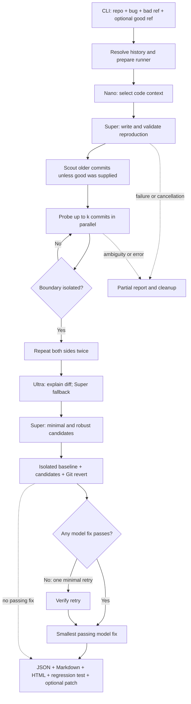

# Culprit architecture

[README and quick start](../README.md) · [Offline example report](index.html)

Culprit's core is a Python CLI. Git/history inspection and patch construction happen on the host; repository code runs in Nebius Sandboxes by default. The explicitly selected local runner is reserved for the bundled demo or repositories trusted with `--i-trust-this-repo`. An optional Flask adapter now exposes the fixed offline demo in a browser; it adds no database or provider substitution.

The optional `culprit.web` app factory serves packaged `web_assets/` and uses one
in-process worker to call the existing `hunt(..., offline=True)`. Requests return a
job ID; polling exposes real `EventLog` entries and engine results. Fix generation
and verification share the engine's existing `fix` stage. The existing renderer
produces report/evidence routes, with a sandboxed iframe preview. Browser input
cannot select arbitrary repositories, paths, commands, or live execution. Render
uses one Gunicorn worker with request threads; restart/eviction discards demo jobs.

**Status:** live Nebius integration is implemented and mock-tested. G2 remains BLOCKED solely by unavailable live credentials. Offline mode substitutes scripted model replies and real local Git/pytest execution; it does not demonstrate live Sandbox or model success.

## Pipeline

The fix stage can be skipped with `--no-fix`. If no model candidate passes, prefer a passing revert; otherwise export no patch. Cancellation and failed stages retain partial evidence. `stage`, model, probe, round, candidate, and completion events feed both the JSONL log and terminal view.

## Execution boundaries

1. The host reads Git objects, builds context, creates the bundle, calls Token Factory, validates model paths, and constructs patches in temporary Git clones. It does not execute the target's code for the default Contree runner.
2. Contree imports `python:3.12-slim`, uploads the bundle and three shell scripts, installs dependencies, and saves a checkpoint with `disposable=False`.
3. Each test/verification uses an isolated `disposable=True` branch of the checkpoint. An asyncio semaphore limits concurrency (default 8; maximum 40). SDK auth stays on the host; guest environments do not inherit host credentials.
4. Local mode uses a separate temporary clone for every run and the current Python installation. It is process isolation for trusted testing, not a security boundary or a separately provisioned historical dependency environment.
5. The shared scripts check out the requested revision. Verification prints exit codes before log tails so truncation does not hide the codes. Truncated failing probes are treated as untrustworthy, not as proof of a bug.

The pinned SDK has no public close or image-delete interface: transport closure and in-flight cancellation are handled explicitly; retained checkpoints are reported under the service's retention policy. An explicit Contree failure never triggers a silent local fallback.

## PASS / FAIL / SKIP

| Observation | Classification | Meaning |
| --- | --- | --- |
| pytest exit 0 | PASS | Reproduction passes; bug absent at this revision |
| pytest exit 1 with the same exception type as the bad revision | FAIL | Reproduces the known failure |
| pytest exit 1 with different known exception types | SKIP | Likely an older incompatible API, not the reported bug |
| Import/collection error (2), no tests (5) | SKIP | Cannot evaluate this revision |
| Cannot open repository (90), checkout (91), dependency install (92), revert conflict (93) | SKIP for probes | Infrastructure/setup failure is not evidence of the bug |
| Timeout, killed process, runner error, truncated failing Sandbox probe | SKIP | Result cannot be trusted |

Exception types and failing test IDs come from pytest summaries. When the reference output cannot identify a failure type, it does not invent a different known type; a generic exit-1 failure remains subject to the existing classifier rules.

Reproduction validation requires an exit-1 failure on bad and a PASS on older code. The scout checks offsets 1, 2, 4, …, 512 plus the root of the inspected first-parent history. It chooses the nearest PASS. All-SKIP results retry reproduction generation; no older PASS otherwise makes the hunt inconclusive. Confirmation repeats the suspected culprit and the preceding good boundary twice each, warning on instability.

## Parallel bisect: a worked example

Commits are indexed oldest to newest, excluding the known-good revision. For 140 commits, `lo=-1` is good and `hi=139` is known bad. Up to eight probes split the interval into roughly nine parts per round. Assume a monotonic failure beginning at index **84**:

| Round | Bounds before | Probe indexes | Latest PASS / earliest FAIL | Suspects remaining |
| --- | --- | --- | --- | --- |
| 1 | -1 … 139 | 15, 30, 46, 61, 77, 92, 108, 123 | 77 / 92 | 15 |
| 2 | 77 … 92 | 79, 80, 82, 84, 85, 87, 89, 90 | 82 / 84 | 2 |
| 3 | 82 … 84 | 83 | 83 / 84 | 1: index 84 |

`expected_rounds(140, 8)` is 3; `expected_rounds(140, 1)` is 8. These are algorithmic worst-case round counts for the clean monotonic case, not measured cloud runtimes. Parallelism trades more probes for fewer sequential waits. Scout results are cached and folded into bounds before bisection, so the actual demo can take fewer rounds. SKIP results are excluded from future probes; an interval containing only skipped unknowns yields an ambiguous list instead of a false unique culprit. A newer PASS after a FAIL produces a non-monotonic/flaky warning.

## Candidate verification and selection

Super returns full file contents for minimal and robust styles. Validate the reply schema, each relative path, permitted new files, duplicates, symlink/gitlink ancestors, and case aliases. Discard attempts to overwrite `tests/test_culprit_regression.py`; Culprit injects the validated reproduction itself.

At the original bad revision, run baseline, minimal, robust, and revert concurrently in independent clones/branches. A candidate passes only if its reproduction exit is zero and its suite either exits zero or has no new failing test IDs relative to the baseline (excluding the injected regression-test ID). Collection/infrastructure errors and missing failure evidence are not passing subsets. If both model fixes fail, retry minimal once using its failure tail.

Build export patches with host Git only. Count added + removed lines excluding the regression test. Prefer the smallest passing model patch over the revert, even when the revert is smaller. Choose the revert only if no model fix passes and the revert does. A hunt may identify the culprit without exporting a patch.

## Module map

| Module | Responsibility |
| --- | --- |
| `cli.py`, `__main__.py` | argparse interface, environment loading, command dispatch, plain/TTY choice |
| `config.py` | Nemotron IDs, endpoint, estimated prices, environment settings |
| `doctor.py` | Configuration, model catalog/suggestions, tiny Nano call, Sandbox access |
| `gitops.py` | Git-only history, bundle and patch helpers; path/tree safety |
| `context.py` | Ranked repository map and Nano-selected context |
| `llm.py`, `prompts.py` | Nebius JSON calls, retries, role usage, scripted offline replies, prompts |
| `hunt.py` | Stage orchestration, repro/scout/search/confirm/explain, cleanup and final evidence |
| `bisect.py` | Probe selection, bounds, inconsistency detection, expected rounds |
| `fixer.py` | Candidate validation, isolated checks, retry and fix selection |
| `runners/base.py`, `runners/scripts.py` | Shared runner contract, classifiers, tar payloads, setup/probe/verify scripts |
| `runners/contree_runner.py` | Nebius SDK auth, checkpoint/branches, concurrency, accounting and cleanup |
| `runners/local_runner.py` | Trusted temporary local clones, process timeout/cancellation |
| `security.py` | Credential redaction and filtered local execution environments |
| `events.py`, `ui.py` | Thread-safe event log and locked Rich Live/plain event views |
| `report.py` | Deterministic JSON, Markdown, escaped self-contained HTML, patch and repro exports |
| `demo_repo.py` | Deterministic 200-commit kirana history and offline answers |
| `scripts/check_demo_repo.py` | Check the demo's own suite at every original commit |
| `scripts/sandbox_smoke.py` | Credential-requiring checkpoint/three-branch live probe, not an offline check |

Paths in this table are relative to `culprit/`, except `scripts/` paths, which are relative to the checkout root. The demo and run artifacts stay ignored. `docs/index.html` is a sanitized, labelled offline report snapshot; it is documentation, not a runtime service or evidence that G2 passed.
